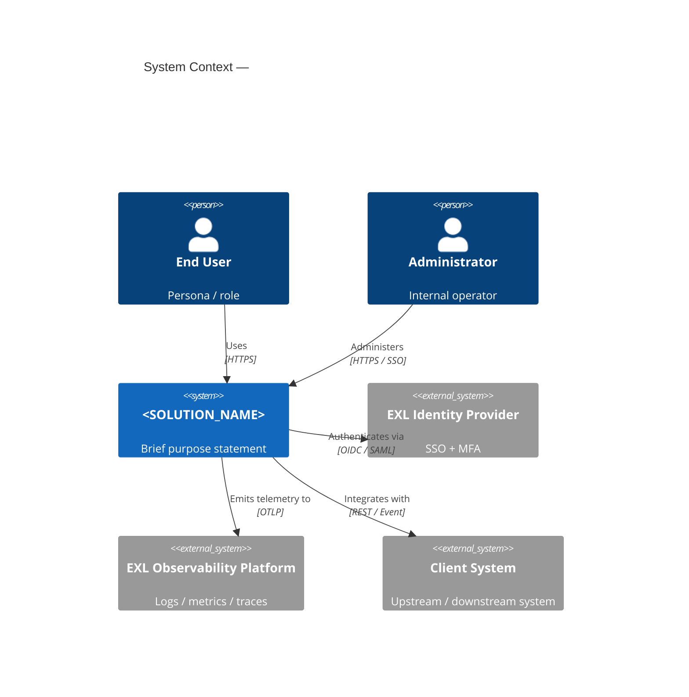
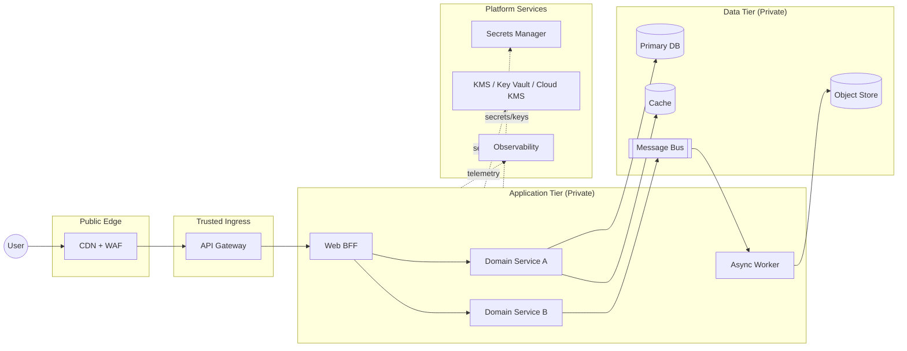
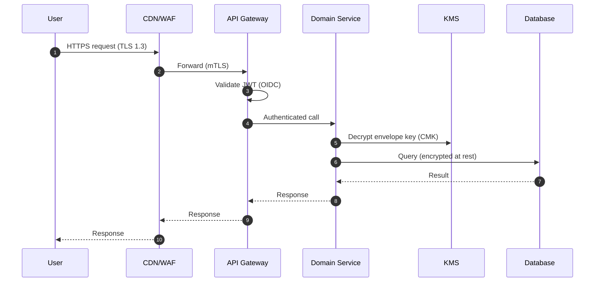

# Architecture Diagram Template (Mermaid / C4)

The `arb-generate-architecture` skill produces three diagrams per design. Use these as the default starting templates. All diagrams use **Mermaid** so they render inline in JIRA, Confluence, GitHub, and the IDE.

---

## 1. C4 Context (Level 1) — who uses the system and what it depends on

---

## 2. C4 Container (Level 2) — the deployable units inside the system

---

## 3. Sequence — the critical request flow

---

## Conventions used by the generator skill

- **Trust zones**: every container diagram has `Public`, `Trusted Ingress`, `Application`, `Data`, `Platform` zones. Anything crossing a boundary is annotated with the protocol and auth mechanism.
- **Data classification**: labels (`[PII]`, `[Regulated]`, `[Internal]`, `[Public]`) decorate stores so reviewers can spot residency / encryption gaps.
- **Provider-neutral naming**: containers use generic terms (API Gateway, Cache, Message Bus). The provider-specific service is named in the SDD's component table, not the diagram.
- **No secrets in diagrams.** Show *that* a secret store exists, never *which* secret.
