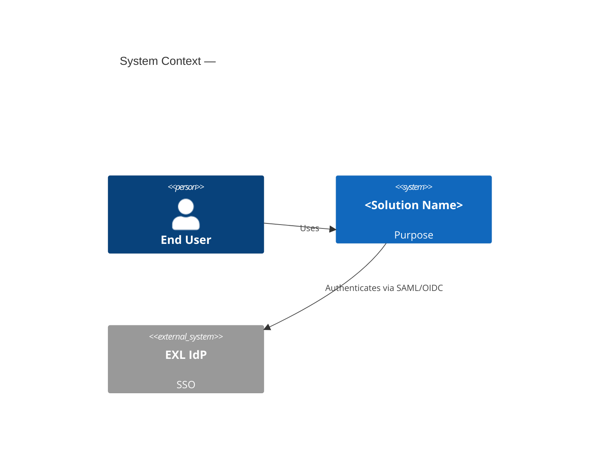
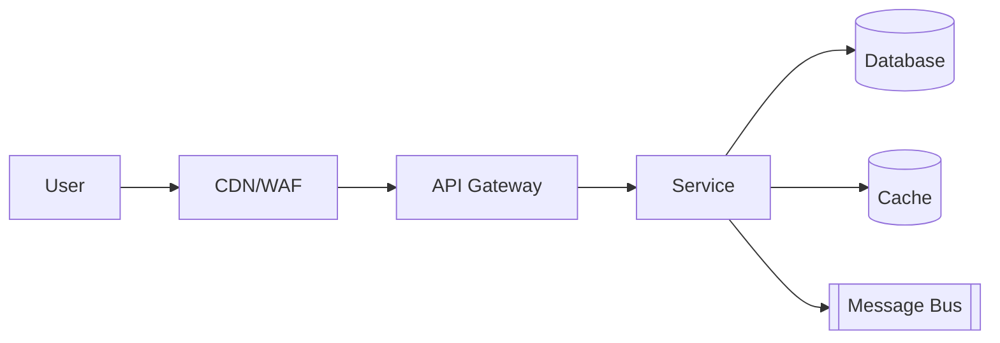
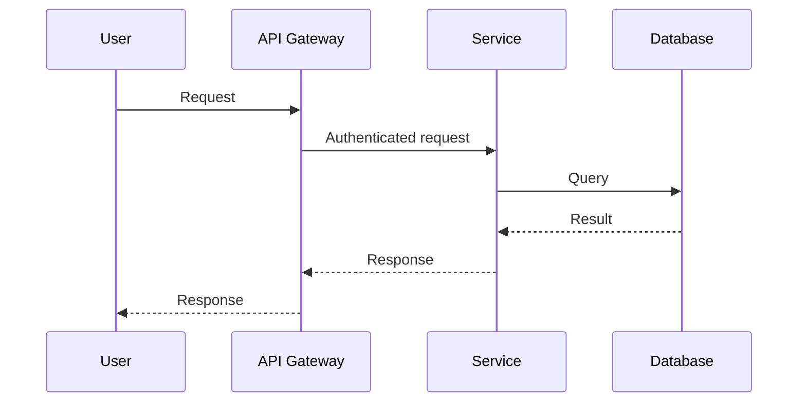

# Solution Design Document (SDD)
## IEEE Std 1016 — Software Design Descriptions

> Fill in each section. Keep prose tight. Where a section does not apply, write "Not applicable" with a one-line reason — do not delete the heading.

---

## 1. Introduction

### 1.1 Purpose
*One paragraph: what this design solves and who reads this document.*

### 1.2 Scope
*In-scope / out-of-scope as bullet lists. Identify the systems and personas in play.*

### 1.3 Definitions, acronyms, and abbreviations
| Term | Definition |
|---|---|
|  |  |

### 1.4 References
*Linked: business case, requirements doc, ADRs, prior SDDs being superseded.*

### 1.5 Document overview
*One-paragraph map to the rest of the SDD.*

---

## 2. Business Context

### 2.1 Business problem and objectives
*What is the client trying to achieve? Measurable outcomes.*

### 2.2 Stakeholders
| Role | Name | Concern |
|---|---|---|
| Product Sponsor |  |  |
| Business Owner |  |  |
| Technical Lead |  |  |
| Architect |  |  |
| Security |  |  |
| Compliance / Privacy |  |  |

### 2.3 Success criteria & KPIs
*Bullet list of measurable outcomes and how they will be measured.*

### 2.4 Constraints
*Budget, timeline, regulatory, geographic, technology constraints.*

### 2.5 Assumptions and dependencies
*External systems, teams, contracts the design depends on.*

---

## 3. Design Identification & Stakeholder Concerns

*Per IEEE 1016, the SDD is organized around design views that address stakeholder concerns. Map them here.*

| Stakeholder | Concern | Design View(s) addressing it |
|---|---|---|
| Security | Identity, data protection, threats | Security View (§7), Deployment View (§6) |
| Operations | Deployability, observability, runbooks | Operational View (§8) |
| Architects | Component decomposition | Logical View (§5) |
| Developers | API contracts, data model | Logical View (§5), Information View (§9) |
| Finance | Cost | Cost View (§10) |

---

## 4. Architecture Drivers

### 4.1 Functional requirements (summary)
*Link to the requirements source-of-truth; do not duplicate.*

### 4.2 Non-functional requirements (quality attributes)
| ID | Attribute | Target | Measure |
|---|---|---|---|
| NFR-1 | Availability | 99.9% | Per service per month |
| NFR-2 | RTO | 1h | Tier-1 |
| NFR-3 | RPO | 15m | Tier-1 |
| NFR-4 | p95 latency | 300ms | API |
| NFR-5 | Throughput | 1000 rps | Sustained |
| NFR-6 | Data residency | EU-only | Regulated data |
| NFR-7 | Accessibility | WCAG 2.1 AA |  |
| NFR-8 | Security | ISO 27001, SOC 2 |  |

### 4.3 Cloud and platform decision
*AWS / Azure / GCP / Multi-cloud — with rationale.*

---

## 5. Logical View (Component Architecture)

### 5.1 Context diagram (C4 - Level 1)

### 5.2 Container diagram (C4 - Level 2)

### 5.3 Component breakdown
| Component | Responsibility | Technology | Owner |
|---|---|---|---|
|  |  |  |  |

### 5.4 Sequence flows (key scenarios)
*One sequence diagram per critical flow.*

---

## 6. Deployment View

### 6.1 Regions and zones
*Primary region(s), DR region(s), and why.*

### 6.2 Network topology
*VPC / VNet / Project layout; subnets; private vs public; transit.*

### 6.3 Environments
| Environment | Purpose | Sizing | Data |
|---|---|---|---|
| Dev |  |  | Synthetic |
| Test |  |  | Anonymized |
| Stage |  |  | Anonymized |
| Prod |  |  | Real |

### 6.4 CI/CD pipeline
*Tool chain, gates, approvals, IaC repo, environment promotion path.*

---

## 7. Security View

### 7.1 Data classification
| Data element | Classification | Storage | Retention |
|---|---|---|---|
|  |  |  |  |

### 7.2 Identity and access
*Human SSO source, workload identity, role model, break-glass procedure.*

### 7.3 Encryption
*In transit (TLS versions), at rest (KMS/Key Vault/Cloud KMS), CMK ownership, rotation.*

### 7.4 Threat model (STRIDE)
| Threat | Affected component | Mitigation |
|---|---|---|
| Spoofing |  |  |
| Tampering |  |  |
| Repudiation |  |  |
| Information disclosure |  |  |
| Denial of service |  |  |
| Elevation of privilege |  |  |

### 7.5 Compliance mapping
*Which controls (SOC 2, ISO 27001, HIPAA, GDPR, PCI, client-specific) and how this design satisfies them.*

---

## 8. Operational View

### 8.1 Observability
*Logs, metrics, traces, dashboards, SLOs, alerts, on-call rotation.*

### 8.2 Runbooks
*Linked operational runbooks for top-N alerts.*

### 8.3 Backup, restore, DR
*RPO/RTO, backup mechanism, test schedule, last test date.*

### 8.4 Capacity and scaling
*Scaling triggers, quotas, expected growth curve.*

---

## 9. Information View (Data Architecture)

### 9.1 Logical data model
*ER or class diagram of the canonical entities.*

### 9.2 Persistence choices
*Per entity / store: technology, why, schema evolution strategy.*

### 9.3 Data flows
*Ingestion, transformation, egress; line up with classification (§7.1).*

### 9.4 Data lifecycle
*Retention, archival, deletion, subject-access-request handling.*

---

## 10. Cost View

### 10.1 Cost model
*Unit cost target (e.g., $/1000 transactions). Monthly steady-state estimate.*

### 10.2 Optimization plan
*Reservations / Savings Plans / CUDs, auto-shutdown, tagging, FinOps review cadence.*

---

## 11. AI / GenAI / Agentic View (if applicable)

*Required if the solution uses GenAI, agentic systems, or ML. See `standards/agentic-best-practices.md`.*

### 11.1 Model selection
*Models used, vendor, hosting (Bedrock / Azure OpenAI / Vertex / EXLerate), data residency.*

### 11.2 Evaluation strategy
*Eval set, metrics, target scores, refresh cadence (eval-driven design).*

### 11.3 Human-in-the-loop (HITL)
*Which actions require human approval; how the loop is implemented; approval SLA.*

### 11.4 Safety and guardrails
*Content filters, prompt injection defenses, PII redaction at prompt boundary, output validation.*

### 11.5 Observability for agents
*Prompt/tool-use logging, trace IDs, eval-result dashboards.*

### 11.6 EXLerate alignment
*Which EXLerate capabilities are reused vs. why custom build is required.*

---

## 12. Decisions and Rationale (ADRs)

| # | Decision | Alternatives considered | Why chosen | Trade-offs |
|---|---|---|---|---|
| ADR-1 |  |  |  |  |
| ADR-2 |  |  |  |  |

### 12.1 Principle compliance matrix
*Map each EXL Architecture Principle (1-18) to: Compliant / Partial / Exception, with rationale and remediation plan for non-compliant items.*

| Principle | Status | Rationale / Remediation |
|---|---|---|
| 1. Simplicity over complexity |  |  |
| 2. Reuse before buy before build |  |  |
| 3. Cloud-agnostic by design, cloud-native by implementation |  |  |
| 4. Data sovereignty and residency first |  |  |
| 5. Identity is the new perimeter |  |  |
| 6. Zero trust networking |  |  |
| 7. Everything as code |  |  |
| 8. Observability is a feature, not an afterthought |  |  |
| 9. FinOps from day one |  |  |
| 10. Resilience by design |  |  |
| 11. Security shifts left |  |  |
| 12. AI/ML and agentic systems are governed |  |  |
| 13. Accessibility and inclusivity |  |  |
| 14. Sustainability |  |  |
| 15. Documentation as a deliverable |  |  |
| 16. Exception process is explicit |  |  |
| 17. Limit unnecessary technology variety |  |  |
| 18. Protect intellectual assets |  |  |

---

## 13. Risks and Mitigations

| ID | Risk | Likelihood | Impact | Mitigation | Owner |
|---|---|---|---|---|---|
|  |  |  |  |  |  |

---

## 14. Roadmap and Milestones

*High-level delivery plan and the architectural decisions tied to each milestone.*

---

## 15. Appendices

- A. Glossary
- B. Out-of-scope and deferred items
- C. Open questions
